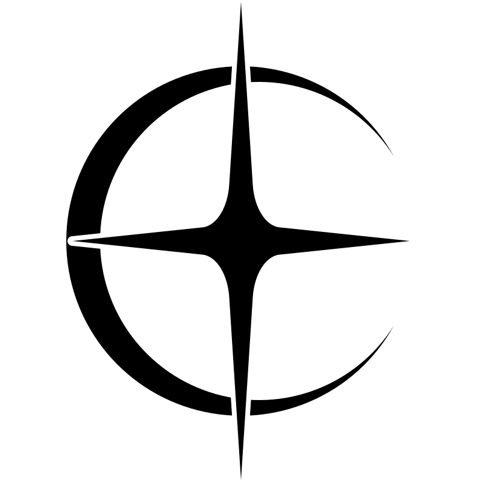

# nanoviews

[![ESM-only package][package]][package-url]
[![NPM version][npm]][npm-url]
[![Dependencies status][deps]][deps-url]
[![Install size][size]][size-url]
[![Build status][build]][build-url]
[![Coverage status][coverage]][coverage-url]

[package]: https://img.shields.io/badge/package-ESM--only-ffe536.svg
[package-url]: https://nodejs.org/api/esm.html

[npm]: https://img.shields.io/npm/v/nanoviews.svg
[npm-url]: https://npmjs.com/package/nanoviews

[deps]: https://img.shields.io/librariesio/release/npm/nanoviews
[deps-url]: https://libraries.io/npm/nanoviews

[size]: https://deno.bundlejs.com/badge?q=nanoviews
[size-url]: https://bundlejs.com/?q=nanoviews

[build]: https://img.shields.io/github/actions/workflow/status/TrigenSoftware/nanoviews/tests.yml?branch=main
[build-url]: https://github.com/TrigenSoftware/nanoviews/actions

[coverage]: https://img.shields.io/codecov/c/github/TrigenSoftware/nanoviews.svg
[coverage-url]: https://app.codecov.io/gh/TrigenSoftware/nanoviews

<picture>
  <source media="(prefers-color-scheme: dark)" srcset="../../website/src/assets/moon_white.svg">
  
</picture>

A small Direct DOM library for building user interfaces.

- **Small**. Between 3.5 and 7 kB (minified and brotlied), signals included.
- **Direct DOM**. Less CPU and memory usage compared to a virtual DOM: the DOM is built once, and signals update it in place.
- **Tree-Shakeable**. Only the code you use is included in your bundle.
- **TypeScript-first**. Elements, attributes, events and components are typed.

## Installation

```bash
pnpm add nanoviews
# or
npm i nanoviews
# or
yarn add nanoviews
```

## Quick Start

Here is a minimal app: a counter component, mounted into the page.

```ts
import { signal } from 'nanoviews/store'
import { main, h1, button, component$, mount } from 'nanoviews'

const Counter = component$(() => {
  const $count = signal(0)

  return (
    button({
      onClick() {
        $count(count => count + 1)
      }
    })(
      'count is ', $count
    )
  )
})

const App = component$(() => (
  main()(
    h1()(
      'Hello, Nanoviews!'
    ),
    Counter()
  )
))

mount(App, document.querySelector('#app')!)
// <main><h1>Hello, Nanoviews!</h1><button>count is 0</button></main>
```

## Documentation

For comprehensive guides, advanced patterns, and API reference, visit the [documentation website](https://nanoviews.js.org/getting-started/).
